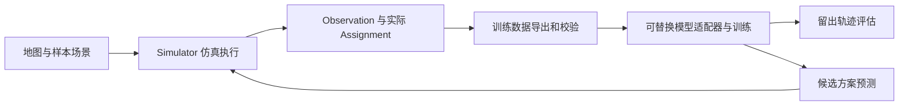

# 本地开发与交接指南

本文用于从 `main` 拉取仓库，运行现有样本转运系统，并开始模型开发。当前系统是公开地图和合成任务上的仿真原型；它不连接真实机器人，也不是已验证的医疗转运系统。内置 PyTorch 小网络用于验证训练接口和闭环，不是最终确定的论文模型。

如果你已有代码，可先在仓库根目录执行 `git pull --ff-only`；若工作区有自己的改动，先检查 `git status`。首次获取：

```bash
git clone https://github.com/lieuyimo/wm.git
cd wm
git switch main
git rev-parse --short HEAD
```

本指南中的所有命令都在仓库根目录执行。示例输出写入 `runs/`；该目录被 Git 忽略，不会自动上传。为避免覆盖已有实验，程序在输出目录非空时会报错；重复运行请更换输出目录名称。

## 1. 最小运行环境

需要 Git 和 Python 3.11 或 3.12。GitHub Actions 使用 Python 3.11，下面的 Linux 流程也在 Python 3.12 上验证过。基础仿真和大部分测试只使用 Python 标准库，不需要 PyTorch、Docker 或 GPU。`python` 命令应指向选定版本；Linux/macOS 若只有 `python3`，请相应替换。

```bash
python --version
python -m unittest discover -s tests -v
python -m lab_transport compare --seed 42 --output runs/developer-demo
```

打开 `runs/developer-demo/world/report.html` 和 `runs/developer-demo/nearest/report.html` 查看离线回放。默认示例包含合成样本、合成时限和规则，不代表真实业务；一次完成 6/6 只说明该测试场景跑通。没有安装 PyTorch 时，神经训练相关的 8 个测试会显示跳过；安装后应运行完整测试。

## 2. 可选：安装 CPU 模型开发环境

仓库的 `requirements-torch-cpu.txt` 固定 PyTorch 2.5.1+cpu 和 NumPy 1.26.4，适用于已确认有官方 wheel 的 **Linux x86-64 / Windows x64**。其他架构或 macOS 请参考 [PyTorch 2.5.1 官方安装说明](https://pytorch.org/get-started/previous-versions/#v251)选择兼容构建；当前代码的设备选项是 `cpu`、`cuda` 和 `auto`，不支持通过 `mps` 选择 Apple GPU。

Linux x86-64 shell 创建环境的方式：

```bash
python3 -m venv runs/dev-venv
runs/dev-venv/bin/python -m pip install -r requirements-torch-cpu.txt
runs/dev-venv/bin/python -m unittest discover -s tests -v
```

macOS 可用相同的虚拟环境路径，但应先按官方说明安装兼容的 PyTorch 2.5.1 和 NumPy 1.26.4。Windows PowerShell：

```powershell
py -3.11 -m venv runs\dev-venv
$Py = ".\runs\dev-venv\Scripts\python.exe"
& $Py -m pip install -r requirements-torch-cpu.txt
& $Py -m unittest discover -s tests -v
```

不必激活虚拟环境；以下 Linux 命令直接使用 `runs/dev-venv/bin/python`。Windows 将每条命令开头替换为 `& $Py` 即可。Linux 命令已从全新克隆实际验证；Windows 命令按 PowerShell 编写，尚未在用户设备上实测。安装完整后，当前版本有 78 项测试且不应因缺少 PyTorch 跳过。浏览器回放的 JavaScript 测试和 GitHub 工作流需要 Node.js；普通仿真不需要 Node.js。

## 3. 数据、训练、恢复和评估

首次使用以下示例需要联网下载固定版本的公开地图及机器人配置，程序会校验 SHA-256。`smoke` 是小规模管线验收；`full` 生成当前固定的完整仿真集。网络不可用时，可通过 `python -m lab_transport.training_data export --help` 查看四个本地源文件参数。数据、工作站用途、任务和扰动的来源及假设见[场景说明](source-backed-hospital-scenario.md)和[多地图实验](multiple-locations-experiment.md)。

Linux shell：

```bash
runs/dev-venv/bin/python -m lab_transport.training_data export --download-sources --profile smoke --output runs/dev-data
runs/dev-venv/bin/python -m lab_transport.training_data validate --dataset runs/dev-data
runs/dev-venv/bin/python -m lab_transport.torch_training --dataset runs/dev-data --output runs/dev-training --device cpu --epochs 1 --train-limit 500 --validation-limit 250
runs/dev-venv/bin/python -m lab_transport.torch_training --dataset runs/dev-data --output runs/dev-training --device cpu --epochs 2 --train-limit 500 --validation-limit 250 --resume runs/dev-training/epoch-0001.pt
runs/dev-venv/bin/python -m lab_transport.torch_evaluate --dataset runs/dev-data --checkpoint runs/dev-training/epoch-0002.pt --output runs/dev-evaluation --device cpu --limit-per-split 100
runs/dev-venv/bin/python -m lab_transport.torch_rollout --checkpoint runs/dev-training/epoch-0002.pt --output runs/dev-rollout --device cpu --download-sources
```

Windows PowerShell 的等价命令：

```powershell
& $Py -m lab_transport.training_data export --download-sources --profile smoke --output runs/dev-data
& $Py -m lab_transport.training_data validate --dataset runs/dev-data
& $Py -m lab_transport.torch_training --dataset runs/dev-data --output runs/dev-training --device cpu --epochs 1 --train-limit 500 --validation-limit 250
& $Py -m lab_transport.torch_training --dataset runs/dev-data --output runs/dev-training --device cpu --epochs 2 --train-limit 500 --validation-limit 250 --resume runs/dev-training/epoch-0001.pt
& $Py -m lab_transport.torch_evaluate --dataset runs/dev-data --checkpoint runs/dev-training/epoch-0002.pt --output runs/dev-evaluation --device cpu --limit-per-split 100
& $Py -m lab_transport.torch_rollout --checkpoint runs/dev-training/epoch-0002.pt --output runs/dev-rollout --device cpu --download-sources
```

主要输出：

| 路径 | 内容 |
| --- | --- |
| `runs/dev-data/manifest.json` | 数据版本、地图及逐场文件哈希、分组和来源；轨迹在 `episodes/` |
| `runs/dev-training/epoch-0001.pt`、`epoch-0002.pt` | 网络、优化器、随机状态和训练配置；`report-through-0002.json` 记录验证集选出的轮次 |
| `runs/dev-evaluation/evaluation.json` | 已固定检查点在留出轨迹上的指标、计数和多步窗口覆盖范围 |
| `runs/dev-rollout/evidence.json`、`decisions.json` | 仿真结果、模型调用预算、候选预测和回退记录 |
| `runs/dev-rollout/playback/report.html` | 调度后的仿真回放 |

这里的 `--train-limit`、`--validation-limit` 和 `--limit-per-split` 仅为快速检查，不能当作完整实验。正式评估前应固定模型、划分和参数，训练使用训练集，选轮次使用验证集，测试集不用于反复调参。多步评估只覆盖特定条件的轨迹窗口，需同时看报告里的排除数量。完整运行命令及更多限制见 [PyTorch 训练与仿真入口](pytorch-training.md)。

恢复时 `--epochs` 是**总轮数**而不是增加轮数，且检查点必须在同一输出目录。数据清单、适配器和共享代码哈希、设备、Python/PyTorch 版本、批次大小、学习率、随机种子及样本限制必须匹配。改动模型代码或改用其他设备时，应新建一次训练；不要把 CPU 训练检查点当作 CUDA 的续训检查点。

## 4. 用户本地 NVIDIA GPU

项目当前只提供 CUDA 设备入口，尚未在用户的设备上验收。先确认本机系统、驱动、GPU 和显存，再创建独立环境，从 [PyTorch 官方 2.5.1 安装说明](https://pytorch.org/get-started/previous-versions/#v251)选择与本机兼容的 CUDA wheel，并安装 `numpy==1.26.4`；不要在此环境使用 CPU 专用的 `requirements-torch-cpu.txt`。

使用该 GPU 环境的 Python 检查：

```bash
python -c 'import torch; print("PyTorch:", torch.__version__, "CUDA 构建:", torch.version.cuda, "CUDA 可用:", torch.cuda.is_available())'
```

Windows PowerShell 可使用相同的 `python -c` 命令或将 `python` 替换成 GPU 虚拟环境中的解释器。确认 CUDA 可用后，在上面的数据准备命令生成数据，再用**新的输出目录**运行训练；把相同训练、恢复、评估和闭环命令中的解释器换成 GPU 环境 Python，并将 `--device cpu` 换为 `--device cuda`。先保留小样本限制，核实训练报告中的设备名和 `peak_gpu_memory_bytes`，再考虑完整数据。显式指定 CUDA 但不可用会报错，不会静默使用 CPU。实际显存、速度、恢复及较大模型的稳定性仍需在本机测量。

例如，Linux 创建独立的 GPU 环境后，若已确认本机驱动与 CUDA 12.1 wheel 兼容，可以使用以下命令；其他情况按官方页面选用兼容的构建，不要盲目照搬 wheel 地址：

```bash
python3 -m venv runs/gpu-venv
runs/gpu-venv/bin/python -m pip install torch==2.5.1 --index-url https://download.pytorch.org/whl/cu121
runs/gpu-venv/bin/python -m pip install numpy==1.26.4
runs/gpu-venv/bin/python -c 'import torch; print(torch.__version__, torch.version.cuda, torch.cuda.is_available())'
runs/gpu-venv/bin/python -m lab_transport.torch_training --dataset runs/dev-data --output runs/dev-gpu-training --device cuda --epochs 1 --train-limit 500 --validation-limit 250
runs/gpu-venv/bin/python -m lab_transport.torch_training --dataset runs/dev-data --output runs/dev-gpu-training --device cuda --epochs 2 --train-limit 500 --validation-limit 250 --resume runs/dev-gpu-training/epoch-0001.pt
```

Windows PowerShell 下可创建同一独立环境，并将解释器替换为 `& $GpuPy`：

```powershell
py -3.11 -m venv runs\gpu-venv
$GpuPy = ".\runs\gpu-venv\Scripts\python.exe"
# 仅在确认本机驱动与 CUDA 12.1 wheel 兼容时使用以下安装源。
& $GpuPy -m pip install torch==2.5.1 --index-url https://download.pytorch.org/whl/cu121
& $GpuPy -m pip install numpy==1.26.4
& $GpuPy -c 'import torch; print(torch.__version__, torch.version.cuda, torch.cuda.is_available())'
& $GpuPy -m lab_transport.torch_training --dataset runs/dev-data --output runs/dev-gpu-training --device cuda --epochs 1 --train-limit 500 --validation-limit 250
& $GpuPy -m lab_transport.torch_training --dataset runs/dev-data --output runs/dev-gpu-training --device cuda --epochs 2 --train-limit 500 --validation-limit 250 --resume runs/dev-gpu-training/epoch-0001.pt
```

上述 CUDA 命令是待本地 GPU 验证的接入步骤；该项目的 CPU 自动测试不能证明它在任何特定 GPU 上可用。

## 5. 目录与主要接口



| 位置 | 作用 |
| --- | --- |
| `scenarios/`、`lab_transport/domain.py` | 示例场景、地图、机器人、样本和站点数据结构 |
| `lab_transport/simulation.py` | 任务生命周期、调度回调、移动/服务与仿真事件 |
| `lab_transport/transition_schema.py` | `Observation`、`Assignment`、`DynamicsModel` 和 `DispatchPolicy` 约定 |
| `lab_transport/training_data.py` | 两张固定来源地图的数据导出与分组、边界、哈希检查 |
| `lab_transport/torch_training.py` | 读取数据、调用适配器、CPU/CUDA 训练与恢复 |
| `lab_transport/torch_smoke_adapter.py` | 可替换的单步神经网络示例，含张量化、损失和预测适配 |
| `lab_transport/torch_evaluate.py`、`torch_rollout.py` | 留出轨迹评估，以及使用预测结果的有预算调度闭环 |
| `lab_transport/world_model.py`、`learned_model.py`、`dynamics_model.py` | 现有规则、线性学习和混合状态预测基线 |
| `tests/`、`.github/workflows/` | 自动化测试与 CPU 工作流 |
| `docs/`、`examples/evidence/`、`validation/` | 场景来源、实验结论和框架验收证据 |
| `runs/` | 本地生成的数据、模型和回放；不提交到 Git |

### 接入自己的模型

1. 新建独立 Python 模块，参考 `lab_transport/torch_smoke_adapter.py` 实现 `ADAPTER_VERSION`、`build_model()`、`encode_transition(...)`、`collate(...)`、`loss(...)` 和 `build_dynamics(...)`。训练器调用 `model(inputs)`；批次当前是张量字典，复杂图、序列或分布式训练可能需要扩展框架。
2. `encode_transition(geometry, observation, assignments, next_observation)` 可以使用下一观测构造**标签**；输入必须只来自当前可见观测、当前候选动作和已知静态地图。不能把未来新任务、未来站点故障、真实剩余服务时间或场次种子放进模型输入。当前模型的单元测试不自动证明新适配器没有泄漏，修改后需要增加相应检查。
3. 使用 `--adapter lab_transport.你的模块名` 指向新模块，并选择新的 `--output` 训练。检查点会记录适配器名及代码哈希；评估和闭环会读取相应适配器。模块名必须是可导入的 Python 标识符，只加载自己信任的适配器和检查点。
4. 模型闭环适配对象需要提供 `predict_next(observation, assignments)`，返回下一步的 `Observation`；内置示例只预测当前已知实体，不预测未来新增任务和故障。当前多步预测是反复调用单步模型，并非序列训练。

自行实现调度策略时，可把函数作为 `Simulator(...).run(dispatch_policy=...)` 的参数；它只接收当前 `Observation` 和当前可选的 `Assignment` 元组，返回合法的分配列表，也可返回空列表等待。仿真器会检查所选任务是否可用及分配是否重复，并检查已实现的离散移动约束；这些检查不等价于现实物理安全或避免所有停滞。`history` 是事后调试回放，可能包含当前模型不应看到的信息，不应用作模型输入。

## 6. 常见问题

- **`ModuleNotFoundError: No module named 'torch'`**：确认执行命令时使用了安装 PyTorch 的虚拟环境解释器；基础仿真不需要该包。
- **`CUDA requested but unavailable`**：检查安装的是 CUDA 构建、NVIDIA 驱动与设备可用性；CPU wheel 不能用于 CUDA。不要把它当作已经通过 GPU 验收。
- **`refusing to overwrite nonempty output directory`**：指定一个新的 `runs/` 子目录；仅在确认需要时自行整理旧实验数据。
- **检查点与代码或数据清单不匹配**：切回训练时的代码和数据，或重新训练到新目录。续训还要求设备及其他训练配置一致。
- **保存检查点时文件系统不支持硬链接**：训练器使用硬链接安全发布检查点；请将项目和输出放在支持硬链接的本地文件系统，例如 Windows 的 NTFS，再重试到新目录。
- **下载固定地图失败或哈希不符**：检查网络和来源文件；也可使用导出命令的本地源文件参数。不要跳过哈希检查或关闭 TLS 验证。
- **需要运行上游 Lay2Graph 验收**：这是独立的 Docker 多服务集成，不是普通本地仿真依赖；从 [框架验收说明](framework-assessment.md) 和 `.github/workflows/lay2graph-integration.yml` 查看固定版本、资源和结果。

本地开发时建议从 `main` 建立功能分支，记录 `git rev-parse HEAD`、数据清单、配置、依赖版本和随机种子。不要提交未经许可的真实病人数据、源地图衍生数据、训练检查点或 `runs/` 内容。

## 7. 本指南的验证记录

2026-11-07，从合并后的 `main`（`2d9334c4d99055f3726d12f3853cd4b978e1cb3a`）全新克隆，在 Linux x86-64、Python 3.12.14、PyTorch 2.5.1+cpu 上执行本指南的基础命令和 CPU 训练链路：78 项测试通过；`smoke` 数据导出和检查得到 16 场、3,357 条转移；训练、恢复、留出评估和医院地图闭环均运行成功。Windows、macOS 和本地 CUDA 命令尚未在用户设备上实测。

合并到 `main` 后的自动化结果：[样本转运原型](https://github.com/lieuyimo/wm/actions/runs/42373439843)、[RGTA 与静态预检](https://github.com/lieuyimo/wm/actions/runs/42373439754)、[Lay2Graph 双机器人闭环](https://github.com/lieuyimo/wm/actions/runs/42373439896)均通过。这些结果均在合成任务或上游示例中获得，不代表真实医疗环境验收。
