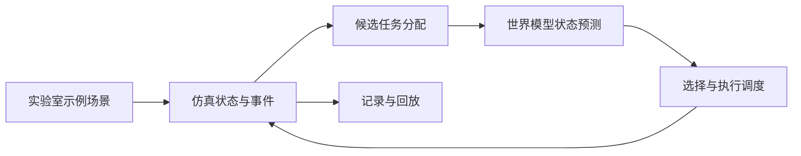

# 毕业论文系统设计材料草稿

本文件依据当前可运行原型整理，可作为论文写作材料；场景既包含合成示例，也包含公开医院路网与脱敏数据的适配，所有映射和参数假设均需单独说明。章节编号、业务需求和最终结果应按学校、导师及实际资料调整，不能直接当成真实实验室验证结论。

## 系统目标与范围

系统面向实验室样本转运的仿真验证。输入包括网格地图或有向导航图、站点、机器人和到达的样本运输任务；输出包括任务分配、仿真过程、预测结果与完成情况。任务指定取样站、送达站和释放步，截止步可缺省。原型可在运行时处理开放的脱敏临床演示数据，但不连接真实实验室设备；演示时序不输出患者标识、绝对日期或检验结果。

## 总体结构

系统由场景配置、状态与仿真、任务调度、世界模型预测和结果展示五部分构成。场景配置加载并检查地图连通性、站点及机器人位置、任务引用和时间参数。仿真模块推进状态；调度模块在有空闲机器人及待处理任务时生成候选分配；预测模块估计各候选动作的后续状态；结果模块记录事件、样本状态及时间轴。

## 核心数据与流程

一个样本任务包含标识、取样站、送达站、释放步及可选截止步；还可记录样本类型、采集时间、包装、温度条件和所选规则。带来源的规则检查按明确指定的机构和样本类型比较已录入字段；缺失信息返回未知，不把仿真交付自动视为实验室实际接收。另有独立启用的人工测试，根据公开规则、采集时间和估计时间模型生成交付代理上限并优先调度较早任务；代理上限及其跨机构适用假设见[时间模型与规则调度说明](timing-and-rule-aware-dispatch.md)。机器人包含标识、位置、当前任务和执行阶段；站点包含位置、服务时间及可配置不可用区间。任务依次经历待释放、待分配、前往取样、运输和完成等状态。每个仿真步依次处理任务释放、分配、站点服务及机器人移动，并记录快照。

当前网格规则保守地禁止进入其他机器人当前占据的单元，并检查同格和对向换边；站点在示例中占据单个单元。该规则适合原型功能测试，但不能证明实际机器人在连续空间中的碰撞安全或系统无死锁。

有向图适配从 [Valner 等的医院实地研究](https://doi.org/10.3389/frobt.2022.922835)公开配置中读取 ICU—实验室路网，保留节点和通行方向。MIMIC-IV 演示集单次 ICU 住院的相对 `charttime` 可作为另一组输入；`charttime` 通常接近采样时间，并非已知的转运请求。把这些记录映射到另一个医院的路网，以及为抽象仿真步赋值，均是明确的测试假设。规则来源和数据限制见[样本规则与公开数据说明](specimen-rules-and-public-data.md)。

## 世界模型原型

对于某一“机器人—样本”候选分配，原型以静态地图最短路径、当前已观察到的站点占用和站点服务时间估计预测取样与完成时间。站点估计在没有观测时使用配置先验，有观测后使用过去完成服务时长的均值，并结合已用服务时间估计剩余占用；预测过程不读取未来的站点中断、随机扰动或仿真器内部实际剩余服务时间。

在此基础上新增一个 CPU 可训练的岭回归残差模型：利用候选路径、当前机器人位置和任务数、站点当前可用性及已观测服务信息，分别修正取样和交付时间预测。训练标签来自仿真中已经执行的分配；输入不包含未来任务、中断或实际剩余服务时间。该模型只预测候选任务的两个时间及最终完成状态，不是视频世界模型，也不预测完整多机器人未来轨迹。

在明确启用的人工规则测试中，可以把规则代理上限的优先顺序与该学习预测组合。不同机器人数量的单例测试中学习预测误差也可能增大，不能预设该组合总是改善效果。

原型依据预测完成时间与预计超时构造候选分数：`score = predicted_completion_tick + 4 × predicted_lateness`，选择分数最小的可用组合。未指定截止步时不计算超时项。系数 4 是当前示例的工程参数，并非经真实数据校准的最优值。该模型未对其他机器人未来轨迹做联合预测，也不是神经网络；后续可依据数据、CPU 资源与导师要求改进。

## 初步功能验证

在仓库提供的合成示例中，2 台机器人处理 6 个样本；两种调度策略均完成全部任务。种子 42 的一次运行中，最近取样点策略为 51 步，预测策略为 55 步。该结果仅用于验证流程，不表明预测策略在本场景更优，也不能作为具有统计意义的性能结论。自动测试覆盖任务状态顺序、离散网格冲突约束、站点中断、预测不读取未来信息、输出回放及超时处理。

后续论文实验应使用事先确定的实验室规则、多个场景和随机种子，报告完成、延迟、预测误差和计算开销，并明确模型与仿真的适用边界。

另一项功能测试将公开 MIMIC 演示集单次 ICU stay 中的 4 个样本相对时序映射到塔尔图医院公开路网，两种策略各完成 4/4；[运行记录及限制](specimen-rules-and-public-data.md)说明了数据来源、规则适用范围和时间步假设。这是跨机构功能测试，不是真实医院转运或临床合规验证。

在固定划分的 30 个留出仿真测试场景中，学习模型在与原预测器相同的已执行决策上具有更低的交付时间预测平均绝对误差，但两者在所有测试场景的任务分配序列相同，任务耗时也没有改善。训练标签、任务及扰动均为仿真数据；详细指标和适用边界见[学习型预测器实验](world-model-experiment.md)。这同时说明预测误差与最终调度收益需要分别评价。

进一步的[多取送点与未见地图实验](multiple-locations-experiment.md)加入公开医院的第二个假设取样点、Open-RMF 诊所演示布局和有限前视对照。20 场中四种策略各完成 120/120 项任务；学习模型在医院场景的部分分配发生变化，在诊所地图的同决策预测误差增大而分配不变。该结果可写入系统测试与限制，不能解释为真实医院性能或跨地图泛化证明。

另实现了 CPU 混合状态转移模型：学习机器人移动和服务完成，以明确规则保持地图邻接与任务状态机。按完整场景种子划分数据后，[首轮](state-transition-experiment.md)和[验证集选择后的第二轮](state-transition-revision.md)整体预测均落后于显式规则参考；模型不生成新任务，也不预知故障，尚未接入调度。多步窗口按事后条件筛选，不能代表已知未来的在线决策。
