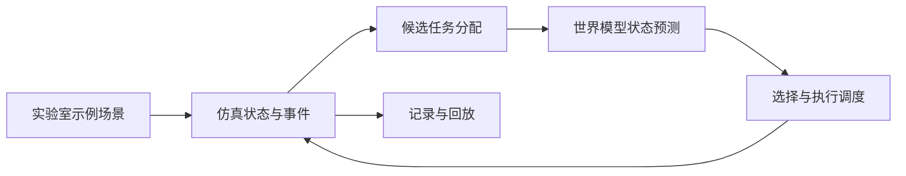

# 毕业论文系统设计材料草稿

本文件依据当前可运行原型整理，可作为论文写作材料；示例场景和参数均为合成假设，章节编号、业务需求和最终结果应按学校、导师及实际资料调整，不能直接当成真实实验室验证结论。

## 系统目标与范围

系统面向实验室样本转运的仿真验证。输入包括二维地图、站点、机器人和持续到达的样本运输任务；输出包括任务分配、仿真过程、预测结果与完成情况。示例任务指定取样站、送达站、释放步和截止步。当前系统不连接真实实验室设备，也不处理真实患者数据。

## 总体结构

系统由场景配置、状态与仿真、任务调度、世界模型预测和结果展示五部分构成。场景配置加载并检查地图连通性、站点及机器人位置、任务引用和时间参数。仿真模块推进状态；调度模块在有空闲机器人及待处理任务时生成候选分配；预测模块估计各候选动作的后续状态；结果模块记录事件、样本状态及时间轴。

## 核心数据与流程

一个样本任务包含标识、取样站、送达站、释放步和截止步；机器人包含标识、网格位置、当前任务和执行阶段；站点包含位置、服务时间及可配置不可用区间。任务依次经历待释放、待分配、前往取样、运输和完成等状态。每个仿真步依次处理任务释放、分配、站点服务及机器人移动，并记录快照。

当前网格规则保守地禁止进入其他机器人当前占据的单元，并检查同格和对向换边；站点在示例中占据单个单元。该规则适合原型功能测试，但不能证明实际机器人在连续空间中的碰撞安全或系统无死锁。

## 世界模型原型

对于某一“机器人—样本”候选分配，原型以静态地图最短路径、当前已观察到的站点占用和站点服务时间估计预测取样与完成时间。站点估计在没有观测时使用配置先验，有观测后使用过去完成服务时长的均值，并结合已用服务时间估计剩余占用；预测过程不读取未来的站点中断、随机扰动或仿真器内部实际剩余服务时间。

原型依据预测完成时间与预计超时构造候选分数：`score = predicted_completion_tick + 4 × predicted_lateness`，选择分数最小的可用组合。系数 4 是当前示例的工程参数，并非经真实数据校准的最优值。该模型未对其他机器人未来轨迹做联合预测，也不是神经网络；后续可依据数据、CPU 资源与导师要求改进。

## 初步功能验证

在仓库提供的合成示例中，2 台机器人处理 6 个样本；两种调度策略均完成全部任务。种子 42 的一次运行中，最近取样点策略为 51 步，预测策略为 55 步。该结果仅用于验证流程，不表明预测策略在本场景更优，也不能作为具有统计意义的性能结论。自动测试覆盖任务状态顺序、离散网格冲突约束、站点中断、预测不读取未来信息、输出回放及超时处理。

后续论文实验应使用事先确定的实验室规则、多个场景和随机种子，报告完成、延迟、预测误差和计算开销，并明确模型与仿真的适用边界。
